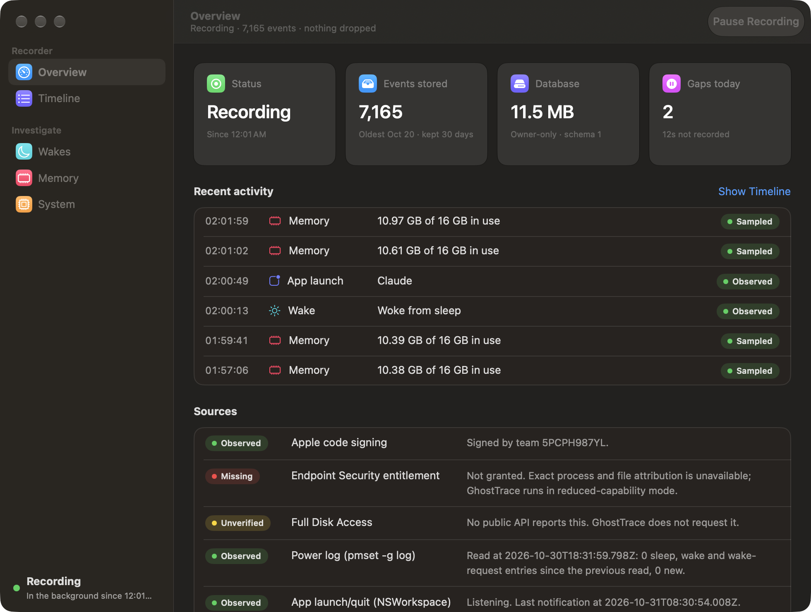
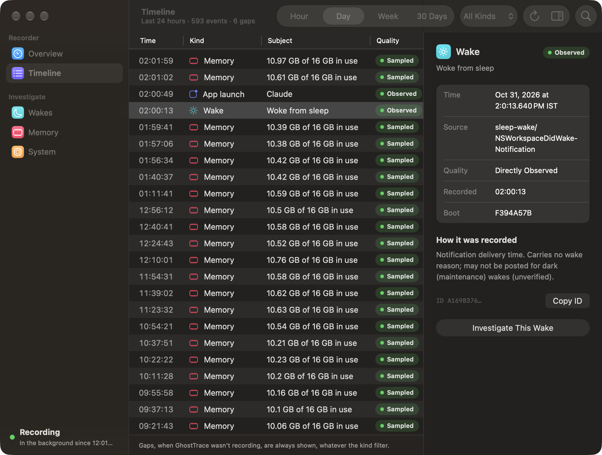
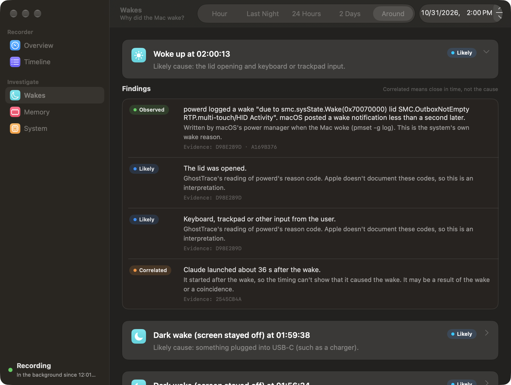
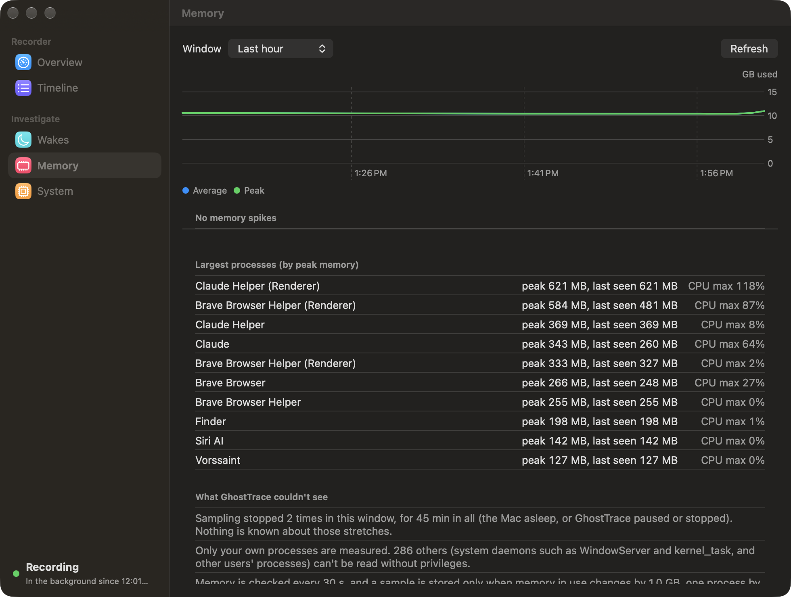
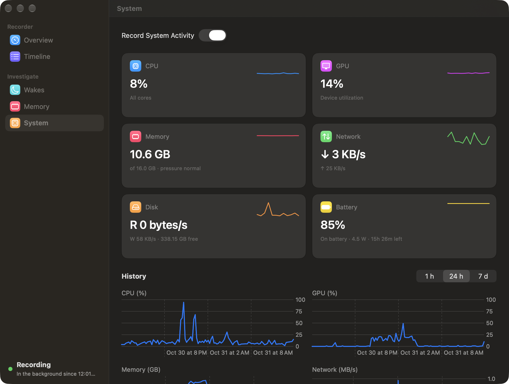
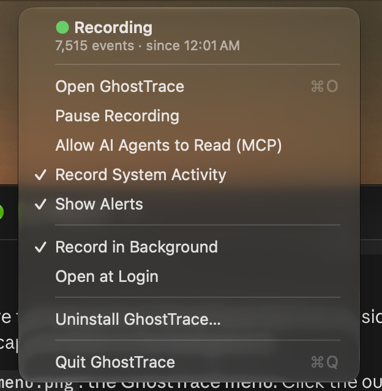

# GhostTrace

A local flight recorder for your Mac. GhostTrace quietly records what happens on the system: apps launching and quitting, sleep and wake, memory and CPU, battery drain, network and disk bursts, and changes to folders you choose. When something odd happens, it explains it from that record. Every answer cites the events it rests on and says how sure it is.

It answers questions like:
- Why did my Mac wake up at 3 a.m.?
- What ate my battery this afternoon?
- Which process filled 20 GB of disk?
- What was using memory when everything slowed down?
- Who changed this file, and when?

Nothing leaves the Mac. There is no network access, no telemetry and no account.

## Screenshots


*Overview: whether recording is on, how much is stored, today's gaps, recent activity, and the status of each source (observed, missing or unverified).*


*Timeline: every recorded event, filterable by time and kind. The inspector shows where an event came from and how it was recorded, and can start an investigation.*


*Wakes: why the Mac woke. Each finding is labelled observed (macOS recorded it), likely (GhostTrace's reading of it) or correlated (close in time, not a cause).*


*Memory: memory in use over time, spikes with the process that grew, the largest processes, and what GhostTrace could not see in that window.*


*System: live CPU, GPU, memory, network, disk and battery, with 1 h, 24 h and 7 d history. "Explain this range" turns a stretch of the charts into battery, network and disk findings.*


*The menu bar menu: recording state, pause and resume, Record System Activity, Show Alerts, agent access, login items and uninstall.*

## What it records

- App launches and quits, and sleep and wake (NSWorkspace).
- The power manager's sleep, wake and wake-request lines (`pmset -g log`).
- Memory and CPU of your own processes, checked every 30 s and stored when something changes, at least every 10 minutes.
- System CPU, GPU, network, disk and battery, with energy and disk writes per process. A switch, Record System Activity, turns this part off.
- Changes under the files and folders you choose to watch (FSEvents): the path and the kind of change, never the contents.

Four alerts are raised from that data, once per incident:
- battery draining fast (under 2 hours left);
- startup disk nearly full (under 10 GB or 5%);
- critical memory pressure;
- CPU or GPU above 80% for 5 minutes while you're away.

## How it works

- **Recorder.** A small background process, run by launchd at login, is the only writer of the database: SQLite in `~/Library/Application Support/GhostTrace`, kept for 30 days. It uses about 5 MB of memory and 0.03% of one CPU core.
- **Clients.** The menu bar app, the window, the `ghosttrace` CLI and the MCP server for AI agents all read through one versioned request contract over XPC. The recorder answers only programs signed by the same developer team.
- **Investigators.** Wake, memory, file-change, battery, network and disk investigators turn events into findings. Each finding has a confidence: observed, likely, correlated or unknown. Each cites event ids and lists what GhostTrace could not see (gaps, unreadable processes, missing sources).
- **Gaps are data.** Stretches when nothing was recorded (the recorder stopped, recording paused, the system monitor off, events dropped) are stored as gap events, so an answer never treats silence as "nothing happened".

The decision records in `docs/adr/` explain each design choice and its costs.

## Install

### Prebuilt zip
`scripts/package.sh` builds `dist/GhostTrace-<version>.zip` with the app, the signed CLI and the docs. The zip is signed with an Apple Development certificate but not notarized, because notarizing needs a paid Developer ID. On any Mac other than the one that built it, Gatekeeper refuses it after download, so building from source is the way to run it.

### Build from source
You need macOS 26 or later, Xcode with an Apple developer account signed in, and your own development team.

1. Set your team on both targets (GhostTraceApp and RecorderAgent) in Xcode, and in `TEAM=` in `scripts/sign-cli.sh` and `scripts/package.sh`.
2. The bundle identifiers start with `com.amoghkhairate.GhostTrace`, which belongs to the author's team. With another team, rename them in:
   - the Xcode project;
   - `App/LaunchAgents/`;
   - `Sources/GhostTraceIPC/` (the XPC service name, log subsystem and alert notification name);
   - the scripts.
3. Build and install:

```bash
xcodebuild -project App/GhostTrace.xcodeproj -scheme GhostTraceApp -configuration Release build
```

```bash
mkdir -p ~/Applications && rm -rf ~/Applications/GhostTrace.app && cp -R ~/Library/Developer/Xcode/DerivedData/GhostTrace-*/Build/Products/Release/GhostTrace.app ~/Applications/
```

```bash
open ~/Applications/GhostTrace.app
```

4. Build and sign the CLI. This prints the path of the signed `ghosttrace`; link it into your `PATH`:

```bash
scripts/sign-cli.sh
```

On first launch the app registers two login items (System Settings > General > Login Items):
- **Record in Background**: launchd starts the recorder at login and restarts it if it stops. Quitting the app doesn't stop recording.
- **Open at Login**: the menu bar icon comes back after you log in.

Install from a fixed place such as `~/Applications`, because the login items point at the app where it was registered. After replacing the app in place, open it once: it registers the new recorder with launchd.

## Using the app

GhostTrace lives in the menu bar as an outlined ghost. Its menu shows whether it's recording and how much is stored, and has:
- Open GhostTrace
- Pause/Resume Recording
- Allow AI Agents to Read (MCP)
- Record System Activity
- Show Alerts
- Record in Background
- Open at Login
- Uninstall
- Quit

The window has five panes: Overview, Timeline, Wakes, Memory and System. It runs as its own process and quits when you close it, so it costs nothing while closed.

**Alerts** are stored as events and shown as macOS banners; clicking one opens the Timeline on that alert. **Show Alerts** turns the banners off; the alerts are still recorded. If macOS isn't allowed to show GhostTrace's banners, the menu says so and opens Notification settings.

**Uninstall GhostTrace…** turns off both login items, stops the recorder and clears the app's settings. It can also move the recorded data to the Trash. Then it shows the app in Finder for you to trash; nothing is ever deleted permanently.

## The CLI

```bash
ghosttrace status
```

```bash
ghosttrace investigate wake --last 24h
```

| Command | What it does |
|---|---|
| `status` | Recorder state, storage, settings and the status of each source |
| `events --last 24h [--kind KIND]` | Recorded events, oldest first, with paging |
| `event ID` | One event with its provenance |
| `investigate wake` | Why the Mac woke, from the power log's own reasons |
| `investigate memory` | Memory spikes and the process that grew |
| `investigate battery` | Drain per stretch on battery, top energy users, dark wakes |
| `investigate network` | Traffic spikes, with the process when `nettop` snapshots show it |
| `investigate disk` | Free-space drops and write bursts, with the top writers |
| `investigate file-change --path P` | Recorded changes to a watched file or folder |
| `memory`, `system` | Memory, or CPU/GPU/network/disk/battery, over a window |
| `watch add/remove/list` | Choose which folders' changes are recorded |
| `config --sample-interval 60s`, `config --system on\|off` | Sampling interval; the system monitor switch |
| `export --last 7d --output FILE` | All events as one JSON file; watched paths hashed unless `--include-sensitive` |
| `pause`, `resume` | Stop and restart recording; the paused span is stored as a gap |
| `logs --last 1h` | The recorder's own diagnostics from the unified log |
| `mcp`, `mcp allow`, `mcp deny` | The MCP server, and turning agent access on or off |

Windows take `--last 90s|30m|24h|7d`, or `--from`/`--to` with ISO 8601 times that include a zone. Investigations take `--at TIME --within 30m`, `--detail` for every finding with its reasoning, and `--json` for the versioned response. Investigations cover up to 48 hours (file changes up to 30 days). Exit codes: 0 ok, 1 error, 2 bad request, 3 recorder not running, 4 permission denied.

## AI agents (MCP)

`ghosttrace mcp` is a local, read-only MCP server on stdin/stdout. Add it to an agent, for example Claude Code:

```bash
claude mcp add ghosttrace -- /absolute/path/to/ghosttrace mcp
```

Agent access is off until you allow it, from the menu or with:

```bash
ghosttrace mcp allow
```

It has ten tools:
- `get_recording_status`
- `list_events`
- `get_event`
- `get_resource_usage`
- `investigate_wake`
- `investigate_memory`
- `investigate_file_change`
- `investigate_battery`
- `investigate_network`
- `investigate_disk`

None of them can pause the recorder or change what it watches. Answers carry event ids and confidence labels for the agent to cite. Listings hide watched paths. Every agent request appears in `ghosttrace logs`. Whatever an agent reads may be sent to its model provider, so read [docs/privacy.md](docs/privacy.md) before allowing it. `ghosttrace mcp deny` turns access off again, also for agents already connected.

## Privacy

- **What it never reads:** file contents, keystrokes and screen content.
- **What it keeps:**
  - for file changes, only the path and the kind of change, under folders you chose (marked sensitive, hashed in exports);
  - from the power log, only sleep, wake and wake-request lines.
- **What it never asks for:** Full Disk Access, privileged entitlements and Endpoint Security, so the process behind a file change is never known for sure.
- **Who can read the data:** the database is owner-only and is served only to programs running as you and signed by the same team, and to AI agents only after you allow them.
- **Erasing:** delete `~/Library/Application Support/GhostTrace`.

The full model is in [docs/privacy.md](docs/privacy.md). If something doesn't work, see [docs/troubleshooting.md](docs/troubleshooting.md).

## What it can't see

- **Your own processes only.** Without privileges, GhostTrace can read only processes running as you. System daemons such as WindowServer and kernel_task count toward system totals, but aren't measured one by one.
- **Wake reasons are interpretations.** They come from `pmset -g log`, whose codes Apple doesn't document, so GhostTrace's readings of them are marked likely. The power log also never says which wake request fired.
- **Sampling misses short events.** Memory and CPU are sampled every 30 s and stored on change, so a spike shorter than one check isn't seen. Each stored sample keeps only the top processes.
- **No process behind a file change.** FSEvents never says which process changed a file, and changes within about a second are merged.
- **Limited per-process network and disk view.** Per-process network comes only from `nettop` snapshots around a spike. APFS snapshots and purgeable space are invisible to the disk investigator.
- **Nothing while stopped.** Nothing is recorded before the recorder first ran, or while it's stopped or paused. Those spans are stored as gaps.
- **Slow wake queries.** Each wake investigation re-reads the power log first, which takes a few seconds.
- **No notarized build.** The app isn't notarized, and the bundle identifiers are tied to the author's team (see Install).

## Resource use

Measured on an Apple silicon MacBook (Release build, 10 minutes idle, on battery). Memory is the `footprint` figure that Activity Monitor shows as "Memory".

| Process | Memory | CPU | Energy impact |
|---|---|---|---|
| Recorder (`RecorderAgent`) | about 5 MB | 0.028% of one core | 0.0 |
| Menu bar app | 11 MB | about 0% | 0.0 |
| Window | 36–53 MB, only while open | — | — |

Storage grows by about 0.2–2 MB a day, depending on activity, and is kept for 30 days.

## Development

```bash
swift test
```

Test and `swift build` binaries aren't team-signed, so they talk to a recorder over a Unix socket in a folder you choose:

```bash
export GHOSTTRACE_HOME=/tmp/gt
```

```bash
swift build && .build/debug/RecorderAgent
```

In a second terminal with the same `GHOSTTRACE_HOME`, `.build/debug/ghosttrace status` talks to that recorder. Only one recorder runs per data folder, so it never collides with the installed one.

| Path | What |
|---|---|
| `Sources/RecorderCore` | Event model, queries, the bounded ingestor, gap events |
| `Sources/Collectors` | App lifecycle, power log, resource sampler, system reader, activity tracker, alerts, `nettop`, FSEvents watcher, capability probe |
| `Sources/EventStore` | SQLite store: migrations, idempotent inserts, paging, retention, corruption recovery |
| `Sources/GhostTraceIPC` | Versioned request/response contract over XPC and a Unix socket |
| `Sources/RecorderAgent` | The recorder process |
| `Sources/InvestigationKit` | The six investigators and the resource analyzer |
| `Sources/GhostTraceCLI`, `Sources/MCPBridge` | The `ghosttrace` CLI and its MCP server |
| `App/` | The SwiftUI and AppKit app, which bundles the recorder and its LaunchAgent |
| `scripts/` | CLI signing, packaging, a read-only soak report |
| `docs/adr/` | Architecture decision records |
| `GhostTrace_Claude_Implementation_Plan.md` | The build plan and its phase-by-phase progress log |

## License

MIT. See [LICENSE](LICENSE).
